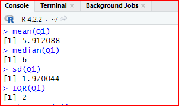
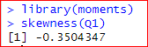
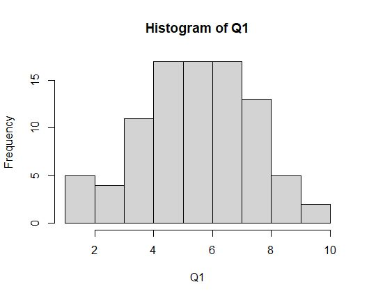
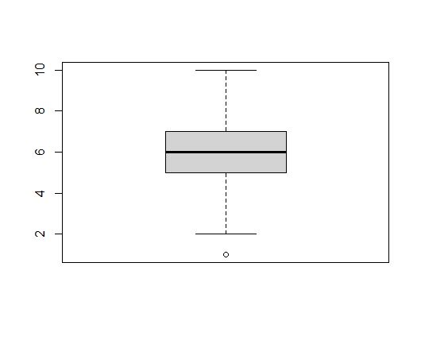
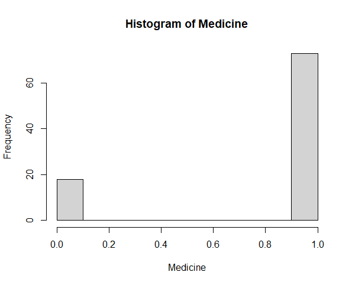
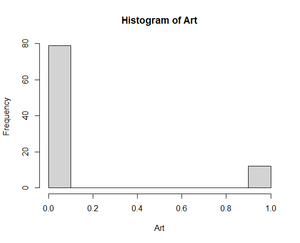
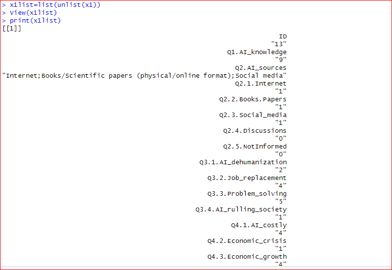
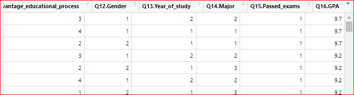

# 🎓 Students' Perceptions of AI in Education — Statistical Survey Analysis

> A **probability & statistics** project that analyses survey data on how undergraduate students perceive the role of **Artificial Intelligence** in education — covering descriptive statistics, distributional shape, visualisations, sectoral impact comparison, and GPA-based filtering — all implemented in **R**.

---

## 📑 Table of Contents

- [Overview](#overview)
- [Problem Statement](#problem-statement)
- [Dataset](#dataset)
- [Key Concepts & Objectives](#key-concepts--objectives)
- [Project Structure](#project-structure)
- [Analysis Breakdown](#analysis-breakdown)
  - [1. Descriptive Statistics](#1-descriptive-statistics)
  - [2. Spread & Distributional Shape](#2-spread--distributional-shape)
  - [3. Visualisations (Histogram & Box Plot)](#3-visualisations-histogram--box-plot)
  - [4. Sectoral AI Impact Analysis](#4-sectoral-ai-impact-analysis)
  - [5. GPA-Based Student Filtering](#5-gpa-based-student-filtering)
- [Sample Outputs](#sample-outputs)
- [Getting Started](#getting-started)
  - [Prerequisites](#prerequisites)
  - [Running the Analysis](#running-the-analysis)
- [Technologies Used](#technologies-used)
- [Report](#report)
- [Author](#author)
- [License](#license)

---

## Overview

This project was developed as part of the **Probability** course (Spring 2024) at **Alamein International University (AIU)**, Faculty of Computer Science and Engineering. It uses real survey data collected from undergraduate students across multiple universities worldwide to explore and quantify how students view the integration of AI technologies in their academic and professional lives.

The analysis spans five main areas:
1. **Descriptive statistics** — summarising AI familiarity scores
2. **Distributional shape** — quantifying skewness and spread
3. **Visualisations** — histograms and box plots
4. **Sectoral impact** — comparing which industries students believe AI will impact most
5. **Student profiling** — filtering responses by GPA to study high-achievers' opinions

---

## Problem Statement

> *How do undergraduate students perceive the integration of AI technologies in education, and what are their expectations regarding AI's role in different industries and in their academic and professional futures?*

The dataset captures students' **familiarity with AI**, their **sources of AI knowledge**, perceived **benefits and drawbacks**, and opinions on AI's impact across sectors such as **Medicine, Education, Agriculture, Marketing, Construction, Administration**, and **Art**.

---

## Dataset

| Property | Detail |
|---|---|
| **Source** | Survey of undergraduate students (2nd & 3rd year) from the Faculty of Cybernetics, Statistics and Economic Informatics, collected across universities worldwide |
| **Observations** | 91 students |
| **Variables** | 35 columns covering demographics, AI familiarity, knowledge sources, perceived benefits/drawbacks, sectoral impact, and academic performance |

### Key Variables Used

| Variable | Description | Type |
|---|---|---|
| `Q1.AI_knowledge` | Self-rated AI familiarity (1–10 scale) | Numeric |
| `Q2.AI_sources` | Sources of AI knowledge (Internet, books, social media, etc.) | Categorical |
| `Q3.*` (Drawbacks) | AI dehumanisation, job replacement, problem-solving concerns, societal ruling | Binary (0/1) |
| `Q4.*` (Benefits) | Cost, economic crisis mitigation, economic growth | Binary (0/1) |
| `Education` – `Art` | "Will AI have a big impact in this sector?" | Binary (0/1) |
| `Q12.Gender` | Gender | Categorical |
| `Q13.Year_of_study` | Academic year | Numeric |
| `Q16.GPA` | Cumulative GPA | Numeric |

---

## Key Concepts & Objectives

| Concept | Objective |
|---|---|
| **Descriptive Statistics** | Compute mean, median, standard deviation, and mode of AI familiarity scores |
| **Interquartile Range (IQR)** | Measure the central 50 % spread of scores to detect consistency |
| **Skewness** | Determine whether the distribution is symmetric, left-skewed, or right-skewed |
| **Histograms & Box Plots** | Visualise the frequency distribution and identify outliers |
| **Sectoral Comparison** | Compare binary responses across 7 sectors to find where students expect AI's biggest/smallest impact |
| **GPA-Based Filtering** | Profile the opinions of the highest-performing students |

---

## Project Structure

```
📦 Students-Perceptions-of-AI-in-Education/
├── 📄 README.md                        # This file
├── 📄 ai_education_survey_analysis.R   # Main R analysis script
├── 📄 R_Project.docx                   # Original project report (full write-up)
└── 📂 screenshots/                     # Plots and output screenshots
    ├── histogram_q1.jpeg               # Histogram of AI familiarity scores
    ├── boxplot_q1.jpeg                 # Box plot of AI familiarity scores
    ├── histogram_medicine.png          # Histogram — Medicine sector impact
    ├── histogram_art.png               # Histogram — Art sector impact
    ├── descriptive_stats_console.png   # Console output: mean, median, sd, IQR
    ├── getmode_function.png            # Custom mode function in R
    ├── skewness_output.png             # Skewness calculation output
    ├── dataset_view_filtered.png       # Filtered dataset view
    ├── dataset_gpa_columns.png         # Dataset columns showing GPA data
    ├── student_record_detail.png       # Detailed record for high-GPA student
    └── ...
```

---

## Analysis Breakdown

### 1. Descriptive Statistics

Computed core summary measures for the **Q1 — AI Familiarity** variable (91 responses, scale 1–10):

```r
Q1 <- c(8,7,5,5,4,5,7,6,6,4,4,6,9,9,7,6,1,8,7,6,
        6,7,7,5,4,5,7,3,6,5,5,6,5,7,6,8,10,8,7,7,
        7,5,8,5,6,3,8,7,9,7,3,4,7,5,5,6,5,8,4,5,
        6,4,8,6,7,5,8,1,6,4,9,10,8,6,5,4,7,4,4,8,
        8,3,7,5,6,1,8,6,9,2,2)

mean(Q1)    # 5.912088
median(Q1)  # 6
sd(Q1)      # 1.970044
getmode(Q1) # 7
```

| Statistic | Value |
|---|---|
| **Mean** | 5.91 |
| **Median** | 6 |
| **Standard Deviation** | 1.97 |
| **Mode** | 7 |

> **Interpretation:** On average, students rate their AI familiarity at roughly **6 out of 10**, with the most common rating being **7** — suggesting moderate-to-good self-assessed awareness.

<p align="center">
  
</p>

---

### 2. Spread & Distributional Shape

```r
IQR(Q1)           # 2
library(moments)
skewness(Q1)      # -0.3504347
```

| Measure | Value | Interpretation |
|---|---|---|
| **IQR** | 2 | The middle 50 % of scores fall within a 2-point range (5–7), indicating fairly concentrated opinions |
| **Skewness** | −0.35 | A slight **negative (left) skew** — the tail stretches toward lower familiarity scores, meaning a few students rated their familiarity very low |

<p align="center">
  
</p>

---

### 3. Visualisations (Histogram & Box Plot)

#### Histogram of AI Familiarity (Q1)

The histogram shows the frequency distribution of self-rated AI familiarity. Scores cluster between **5–7**, confirming the moderate familiarity trend.

<p align="center">
  
</p>

#### Box Plot of AI Familiarity (Q1)

The box plot highlights the **median at 6**, IQR spanning 5–7, and a single **outlier** at the lower end.

<p align="center">
  
</p>

---

### 4. Sectoral AI Impact Analysis

Students were asked: *"In which area do you think AI would have a big impact?"* (binary Yes/No per sector).

| Sector | Mean (proportion saying "Yes") | Rank |
|---|---|---|
| 🏥 **Medicine** | **0.8022** | 🥇 Highest |
| 🎓 **Education** | 0.6703 | 🥈 |
| 🏗️ **Constructions** | 0.5495 | 🥉 |
| 🌾 **Agriculture** | 0.5055 | 4th |
| 💼 **Administration** | 0.3846 | 5th |
| 📣 **Marketing** | 0.3626 | 6th |
| 🎨 **Art** | **0.1319** | 🔻 Lowest |

> **Key Finding:** Over **80 %** of students believe AI will have a major impact on **Medicine**, while only **~13 %** see a significant impact on **Art**.

<p align="center">
  
  &nbsp;&nbsp;&nbsp;
  
</p>
<p align="center"><em>Left: Medicine (highest impact) — Right: Art (lowest impact)</em></p>

---

### 5. GPA-Based Student Filtering

The analysis filters the dataset to examine the survey responses of the **highest-GPA students** (GPA ≈ 9.2–9.7).

```r
x1 <- af[13, ]    # Student ID 13 — GPA 9.7
x2 <- af[59, ]    # Another high-GPA student
x3 <- af[61, ]    # Another high-GPA student
```

<p align="center">
  
</p>

> **Observation:** High-GPA students tend to have **higher AI familiarity scores** and use **multiple knowledge sources** (Internet, books/scientific papers, social media). They also express concerns about AI's potential drawbacks such as job replacement and societal impact.

<p align="center">
  
</p>

---

## Sample Outputs

| Output | Preview |
|---|---|
| Histogram of AI Familiarity |  |
| Box Plot of AI Familiarity |  |
| Medicine Sector Histogram |  |
| Art Sector Histogram |  |

---

## Getting Started

### Prerequisites

| Requirement | Version |
|---|---|
| **R** | ≥ 4.2.0 |
| **RStudio** (recommended) | ≥ 2023.06 |
| **`moments` package** | any |

### Running the Analysis

1. **Clone the repository**
   ```bash
   git clone https://github.com/<your-username>/Students-Perceptions-of-AI-in-Education.git
   cd Students-Perceptions-of-AI-in-Education
   ```

2. **Install the required R package** (first time only)
   ```r
   install.packages("moments")
   ```

3. **Open & run the script**
   - Open `ai_education_survey_analysis.R` in **RStudio**
   - Click **Source** or run line-by-line with `Ctrl + Enter`
   - Plots will appear in the **Plots** pane; statistics are printed to the **Console**

4. *(Optional)* If you have the full survey CSV, uncomment the `read.csv()` line at the top of the script and update the path.

---

## Technologies Used

| Tool | Purpose |
|---|---|
| **R** | Core statistical computing and plotting |
| **Base R Graphics** | Histograms, box plots |
| **`moments`** | Skewness calculation |
| **`tabulate` / `match`** | Custom mode function |
| **RStudio** | IDE for interactive analysis |

---

## Report

The full project report (including all analysis, code screenshots, and interpretations) is available in [`R_Project.docx`](R_Project.docx).

---

## Author

**Tasneem Ibrahim Hassan Mohamed**
- 🎓 Faculty of Computer Science and Engineering — Alamein International University (AIU)
- 📧 Student ID: 22101382
- 📅 Spring 2024

---

## License

This project is open-source and available under the [MIT License](LICENSE).
